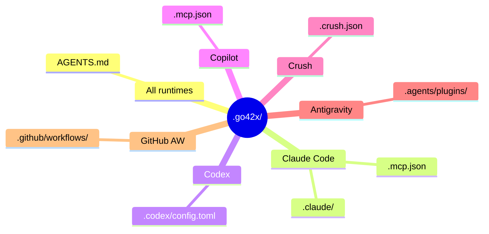

<div align="center"><pre>
░██████╗░░█████╗░░░██╗██╗░█████═╗░██╗░░██╗░
██╔════╝░██╔══██╗░██╔╝╚█║█════██║░╚██╗██╔╝░
██║░░██╗░██║░░██║██╔╝░░╚╝░░███╔═╝░░╚███╔╝░░
██║░░╚██╗██║░░██║███████╗██╔══╝░░░░██╔██╗░░
╚██████╔╝╚█████╔╝╚════██║███████║░██╔╝╚██╗░
░╚═════╝░░╚════╝░░░░░░╚═╝╚══════╝░╚═╝░░╚═╝░
</pre></div>
<p align="center">
<a href="https://opensource.org/licenses/MIT"></a>
<a href="https://golang.org/"></a>
<a href="https://github.com/go42-dev/go42x/releases"></a>
</p>

# go42x

go42x sets up and maintains the AI agent environment for go42-based projects. It generates consistent instructions,
skills, and MCP configuration for every supported agent from one project config, and gives agents a searchable
knowledge base, a task journal, and pinned upstream references.

## Installation

### Homebrew

```bash
brew tap go42-dev/go42x
brew install go42x
```

### Go

```bash
go install github.com/go42-dev/go42x@latest
```

### Download Binary

Download the latest binary from the [releases page](https://github.com/go42-dev/go42x/releases).

## Features

One project configuration generates the files every agent runtime needs:



| Feature                           | What it gives                                                                                                                                                                                   | How to use                                                                       |
| --------------------------------- | ----------------------------------------------------------------------------------------------------------------------------------------------------------------------------------------------- | -------------------------------------------------------------------------------- |
| Agent environment generation      | One config and template produce instructions, settings, skills, and MCP for Claude Code, Codex, Copilot, Crush, Antigravity, and GitHub Agentic Workflows                                       | `go42x agentenv init`, then `generate`; personal overrides in `go42x.local.yaml` |
| Environment context               | Project, Git, Go toolchain, and CI details in agent instructions, so agents know the real Go version, OS, and paths                                                                             | Automatic in `go42x agentenv generate`                                           |
| Modular instructions              | `AGENTS.md` assembled from chunks (definitions, operation, journal, reporting, search, code style); override or add one chunk at a time                                                         | `.go42x/chunks/`                                                                 |
| Bundled guidance and safe updates | Code style, vendored Go and Google style guides, skills, and MCP configuration (gopls, go42x, mise, Context7, GitHub, GitLab, Jira, JetBrains); updates merge with local edits and keep backups | `go42x agentenv update`                                                          |
| Knowledge base search             | Incremental index of docs and source with stale-result detection                                                                                                                                | `go42x kwb build`, `search`, `check`                                             |
| MCP server                        | Search, file reads, project context, documentation lookup, and the journal for agents                                                                                                           | `go42x mcp`                                                                      |
| Task journal                      | Per-task notes and working files, so any session can continue the task                                                                                                                          | `go42x agentenv journal new`, `list`, `note`, `done`, `gc`                       |
| Upstream file vendoring           | Pinned files from Git, HTTP, npm, or Confluence, locked with checksums                                                                                                                          | `go42x vendor update`, `sync`, `check`; `--dry-run` previews                     |
| Doctor                            | Checks configuration, generated files, MCP setup, and index freshness                                                                                                                           | `go42x doctor`; `--probe-mcp` tests servers                                      |
| Scriptable output                 | Machine-readable results for CI and scripts                                                                                                                                                     | `--json` on most commands                                                        |
