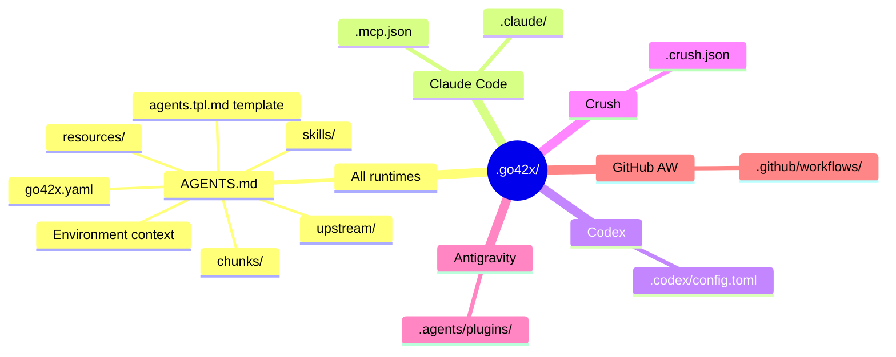

<div align="center"><pre>
░██████╗░░█████╗░░░██╗██╗░█████═╗░██╗░░██╗░
██╔════╝░██╔══██╗░██╔╝╚█║█════██║░╚██╗██╔╝░
██║░░██╗░██║░░██║██╔╝░░╚╝░░███╔═╝░░╚███╔╝░░
██║░░╚██╗██║░░██║███████╗██╔══╝░░░░██╔██╗░░
╚██████╔╝╚█████╔╝╚════██║███████║░██╔╝╚██╗░
░╚═════╝░░╚════╝░░░░░░╚═╝╚══════╝░╚═╝░░╚═╝░
</pre></div>
<p align="center">
<a href="https://opensource.org/licenses/MIT"></a>
<a href="https://golang.org/"></a>
<a href="https://github.com/go42-dev/go42x/releases"></a>
</p>

# go42x

go42x sets up and maintains the AI agent environment for go42-based projects. It generates consistent instructions,
skills, and MCP configuration for every supported agent from one project config, and gives agents a searchable
knowledge base, a task journal, and pinned upstream references.

## Installation

### Homebrew

```bash
brew tap go42-dev/go42x
brew install go42x
```

### Go

```bash
go install github.com/go42-dev/go42x@latest
```

### Download Binary

Download the latest binary from the [releases page](https://github.com/go42-dev/go42x/releases).

## Supported runtimes

| Runtime                  | Where it runs  | Supported features                                                                 |
| ------------------------ | -------------- | ---------------------------------------------------------------------------------- |
| Claude Code              | Local          | Instructions, MCP servers, skills, tool permissions, subagents                     |
| Codex                    | Local          | Instructions with size budget, MCP servers, skills                                 |
| Crush                    | Local          | Instructions, MCP servers                                                          |
| Antigravity              | Local          | Instructions, MCP servers through a workspace plugin, skills                       |
| GitHub Agentic Workflows | GitHub Actions | Instructions, MCP servers, skills; `copilot`, `claude`, `codex`, and `agy` engines |

## Features

One project configuration generates the files every agent runtime needs:



| Feature                           | What it gives                                                                                            | How to use                                                                       |
| --------------------------------- | -------------------------------------------------------------------------------------------------------- | -------------------------------------------------------------------------------- |
| Agent environment generation      | Generates every agent runtime's files from one project configuration, so all agents share the same setup | `go42x agentenv init`, then `generate`; personal overrides in `go42x.local.yaml` |
| Environment context               | Puts the project's real environment into agent instructions, so agents don't guess versions or paths     | Automatic in `go42x agentenv generate`                                           |
| Modular instructions              | Builds `AGENTS.md` from small parts that you override or extend one at a time                            | `.go42x/chunks/`                                                                 |
| Bundled guidance and safe updates | Ready-made agent guidance and configuration that update without losing your local edits                  | `go42x agentenv update`                                                          |
| Knowledge base search             | A local search index over the project that knows when its results are out of date                        | `go42x kwb build`, `search`, `check`                                             |
| MCP server                        | Gives agents project search, documentation, and the journal as tools                                     | `go42x mcp`                                                                      |
| Task journal                      | A record of each task's notes and working files, so any session can continue it                          | `go42x agentenv journal new`, `list`, `note`, `gc`                               |
| Upstream file vendoring           | Keeps copies of external files in the project, pinned and verified                                       | `go42x vendor update`, `sync`, `check`; `--dry-run` previews                     |
| Doctor                            | Checks that the go42x setup is complete and current                                                      | `go42x doctor`; `--probe-mcp` tests servers                                      |
| Scriptable output                 | Machine-readable results for CI and scripts                                                              | `--json` on most commands                                                        |
